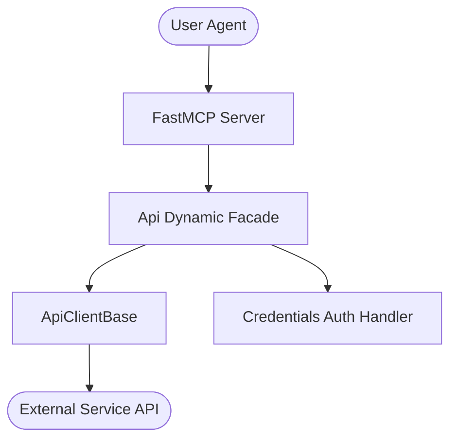

# Mattermost MCP

[](https://github.com/genius-agents/mattermost-mcp)
[](pyproject.toml)
[](LICENSE)

Mattermost enterprise messaging collaboration server. Built with the highest architectural standards, incorporating dynamic facades, custom API routing, and FastMCP tool decoration.

> **Documentation** — Installation, deployment, usage across the API, CLI, and MCP
> platform are maintained in the
> [official documentation](https://knuckles-team.github.io/mattermost-mcp/).

## Table of Contents
- [Overview](#overview)
- [Features](#features)
- [Installation](#installation)
- [Usage](#usage)
- [Environment Variables](#environment-variables)
- [MCP Tools](#mcp-tools)
- [Architecture](#architecture)
- [Deployment](#deployment)
- [Contributing](#contributing)
- [License](#license)

---

## Overview

Mattermost MCP provides a high-performance, model-optimized interface to Mattermost capabilities. It isolates the model from underlying API transport complexity, ensuring safe, idempotent, and highly traceable system interactions.

---

## Features

- **Dynamic Facade Orchestration**: Integrates multi-inheritance clients cleanly under a single facade.
- **Battle-Tested Resilience**: Out-of-the-box credential authentication, connection polling, and request retry strategies.
- **FastMCP Declarative Tools**: Fast, native schema registration with full inline validation.
- **Complete Test Intent Diversity**: Deep, automated unit, integration, and mock tests ensuring high code coverage.

---

## ⚙️ Dynamic Tool Selection & Visibility

This MCP server supports dynamic toolset selection and visibility filtering at runtime. This allows the operator to restrict the set of exposed tools to prevent blowing up the LLM's context window.

The operator can configure tool filtering via multiple input channels:

- **CLI Arguments:** Pass `--tools` or `--toolsets` (or their disabled counterparts `--disabled-tools` and `--disabled-toolsets`) during startup.
- **Environment Variables:** Define standard environment variables:
  - `MCP_ENABLED_TOOLS` / `MCP_DISABLED_TOOLS`
  - `MCP_ENABLED_TAGS` / `MCP_DISABLED_TAGS`
- **HTTP SSE Request Headers:** Pass custom headers during transport initialization:
  - `x-mcp-enabled-tools` / `x-mcp-disabled-tools`
  - `x-mcp-enabled-tags` / `x-mcp-disabled-tags`
- **HTTP SSE Request Query Parameters:** Append query parameters directly to the operator's transport connection URL:
  - `?tools=tool1,tool2`
  - `?tags=tag1`

When query strings or parameters are provided, an LLM-free **Knowledge Graph resolution layer** (using `DynamicToolOrchestrator`) matches query intents against known tool tags, names, or descriptions, with safe fallback and automated 24-hour background cache refreshing.

---

## Installation

Pick the extra that matches what the operator want to run:

| Extra | Installs | Use when |
|-------|----------|----------|
| `mattermost-mcp[mcp]` | Connector-focused MCP server (`agent-connector-sdk` — FastMCP/FastAPI + `epistemic-graph[full]`) | The operator only run the **MCP server** (smallest install / image) |
| `mattermost-mcp[all]` | Everything (`mcp` + `agent` + `logfire`) | Development / both surfaces |

```bash
# Connector-focused MCP server (includes the shared graph engine)
uv pip install "mattermost-mcp[mcp]"

# Agent runtime (adds model orchestration to the shared graph engine)

# Everything (development)
uv pip install "mattermost-mcp[all]"      # or: python -m pip install "mattermost-mcp[all]"
```

### Container images (`:mcp`)

One multi-stage `docker/Dockerfile` builds the MCP-only image (`--target mcp`):

| Image tag | Build target | Contents | Entrypoint |
|-----------|--------------|----------|------------|
| `example/mattermost-mcp:mcp` | `--target mcp` | `mattermost-mcp[mcp]` — **connector-focused**, includes `epistemic-graph[full]`; no model-orchestration stack | `mattermost-mcp` |

```bash
docker build --target mcp   -t example/mattermost-mcp:mcp    docker/   # connector-focused MCP server
```

agent (`immutable agent digest`) with a co-located `:mcp` sidecar.

### Knowledge-graph database (`epistemic-graph`)

Agent Connector SDK core dependency (`epistemic-graph[full]`). The `[mcp]` extra keeps
deployments can use the bundled engine. For production or shared state, run
**epistemic-graph as a dedicated database service** and configure the runtime to use it.
Deployment recipes (single-node + Raft HA), connection configuration, and architecture
diagrams are documented in the
[epistemic-graph deployment guide](https://knuckles-team.github.io/epistemic-graph/deployment/).

---

## Usage

The operator can start the FastMCP server in stdio mode via Python module execution:

```python
import asyncio
from mattermost_mcp.mcp_server import get_mcp_instance


async def main():
    mcp = get_mcp_instance()
    # Execute stdio loop or launch server
    print("MCP Server ready.")


if __name__ == "__main__":
    asyncio.run(main())
```

For direct shell start, run:

```bash
python -m mattermost_mcp.mcp_server
```

---

## Tool names: v2.2.x to v2.3.0+

Up to v2.2.x this server served 57 tools: 53 action-routed group tools named
`mattermost_mcp_<group>` (an `action` string plus `params_json`) and the 4
`mattermost_ingest_*` tools. v2.2.0 changed neither the names nor the server name
(`Mattermost MCP MCP`); the names changed in v2.3.0, when every action became its own
typed tool. The rule is `mattermost_mcp_<group>(action="X")` -> `mattermost_X`. The
4 `mattermost_ingest_*` tools keep their names; since v2.4.0 they take typed filters
instead of `params_json`. One action has no successor:
`mattermost_mcp_reactions(action="get_bulk_reactions")`, because the Mattermost
v11.11.1 API v4 spec (the deployed server's version) no longer lists it. It is
declared in `[tool.pipelines] retired-tools`.

Types come from the official Mattermost API v4 OpenAPI source
(`mattermost/mattermost` `api/v4/source`, published at api.mattermost.com) at
v11.11.1, which is the deployed server's version. A body field whose name is a Python
keyword (`from`) keeps its name in the tool schema through a pydantic field alias
(agent-connector-sdk 0.3.8); the client receives it as `from_` and sends `from`.

<details><summary>Full mapping (53 group tools, 578 actions)</summary>

| Tool served up to v2.2.x | Actions | Per-operation successors since v2.3.0 (`action=X` → `mattermost_X`) |
|---|---|---|
| `mattermost_mcp_access_control` (action=…) | 17 | `mattermost_create_access_control_policy`, `mattermost_check_access_control_policy_expression`, `mattermost_validate_expression_against_requester`, `mattermost_test_access_control_policy_expression`, `mattermost_simulate_access_control_policy_for_users`, `mattermost_search_access_control_policies`, `mattermost_get_access_control_policy_autocomplete_fields`, `mattermost_get_access_control_policy`, `mattermost_delete_access_control_policy`, `mattermost_update_access_control_policy_active_status`, `mattermost_assign_access_control_policy_to_channels`, `mattermost_unassign_access_control_policy_from_channels`, `mattermost_get_channels_for_access_control_policy`, `mattermost_search_channels_for_access_control_policy`, `mattermost_get_channel_access_control_attributes`, `mattermost_get_c_e_l_visual_a_s_t`, `mattermost_update_access_control_policies_active` |
| `mattermost_mcp_actions` (action=…) | 3 | `mattermost_open_interactive_dialog`, `mattermost_submit_interactive_dialog`, `mattermost_lookup_interactive_dialog` |
| `mattermost_mcp_agents` (action=…) | 3 | `mattermost_get_agents`, `mattermost_get_agents_status`, `mattermost_get_l_l_m_services` |
| `mattermost_mcp_audit_logging` (action=…) | 2 | `mattermost_add_audit_log_certificate`, `mattermost_remove_audit_log_certificate` |
| `mattermost_mcp_boards` (action=…) | 1 | `mattermost_create_board` |
| `mattermost_mcp_bookmarks` (action=…) | 5 | `mattermost_list_channel_bookmarks_for_channel`, `mattermost_create_channel_bookmark`, `mattermost_delete_channel_bookmark`, `mattermost_update_channel_bookmark`, `mattermost_update_channel_bookmark_sort_order` |
| `mattermost_mcp_bots` (action=…) | 8 | `mattermost_get_bots`, `mattermost_create_bot`, `mattermost_get_bot`, `mattermost_patch_bot`, `mattermost_disable_bot`, `mattermost_enable_bot`, `mattermost_assign_bot`, `mattermost_convert_bot_to_user` |
| `mattermost_mcp_brand` (action=…) | 3 | `mattermost_get_brand_image`, `mattermost_upload_brand_image`, `mattermost_delete_brand_image` |
| `mattermost_mcp_channels` (action=…) | 60 | `mattermost_get_all_channels`, `mattermost_create_channel`, `mattermost_create_direct_channel`, `mattermost_create_group_channel`, `mattermost_search_all_channels`, `mattermost_search_group_channels`, `mattermost_get_public_channels_by_ids_for_team`, `mattermost_get_channel_members_timezones`, `mattermost_get_channel`, `mattermost_update_channel`, `mattermost_delete_channel`, `mattermost_patch_channel`, `mattermost_update_channel_privacy`, `mattermost_restore_channel`, `mattermost_move_channel`, `mattermost_get_channel_stats`, `mattermost_get_pinned_posts`, `mattermost_get_public_channels_for_team`, `mattermost_get_private_channels_for_team`, `mattermost_get_recommended_channels_for_team`, `mattermost_get_deleted_channels_for_team`, `mattermost_autocomplete_channels_for_team`, `mattermost_autocomplete_channels_for_team_for_search`, `mattermost_get_managed_categories`, `mattermost_search_channels`, `mattermost_get_channel_by_name`, `mattermost_get_channel_by_name_for_team_name`, `mattermost_get_channel_members`, `mattermost_add_channel_member`, `mattermost_set_channel_members`, `mattermost_get_channel_members_by_ids`, `mattermost_get_channel_member`, `mattermost_remove_user_from_channel`, `mattermost_update_channel_roles`, `mattermost_update_channel_member_scheme_roles`, `mattermost_update_channel_notify_props`, `mattermost_update_channel_member_autotranslation`, `mattermost_mark_channels_read_for_user`, `mattermost_get_channels_member_count`, `mattermost_view_channel`, `mattermost_mark_all_direct_messages_read`, `mattermost_get_channel_members_for_user`, `mattermost_get_channels_for_team_for_user`, `mattermost_get_channels_for_user`, `mattermost_get_channel_unread`, `mattermost_update_channel_scheme`, `mattermost_channel_members_minus_group_members`, `mattermost_get_channel_member_counts_by_group`, `mattermost_get_channel_moderations`, `mattermost_patch_channel_moderations`, `mattermost_get_sidebar_categories_for_team_for_user`, `mattermost_create_sidebar_category_for_team_for_user`, `mattermost_update_sidebar_categories_for_team_for_user`, `mattermost_get_sidebar_category_order_for_team_for_user`, `mattermost_update_sidebar_category_order_for_team_for_user`, `mattermost_get_sidebar_category_for_team_for_user`, `mattermost_update_sidebar_category_for_team_for_user`, `mattermost_remove_sidebar_category_for_team_for_user`, `mattermost_get_group_message_members_common_teams`, `mattermost_convert_group_message_to_channel` |
| `mattermost_mcp_cloud` (action=…) | 15 | `mattermost_get_cloud_limits`, `mattermost_get_cloud_products`, `mattermost_get_cloud_customer`, `mattermost_update_cloud_customer`, `mattermost_update_cloud_customer_address`, `mattermost_validate_business_email`, `mattermost_validate_workspace_business_email`, `mattermost_get_subscription`, `mattermost_get_endpoint_for_installation_information`, `mattermost_get_invoices_for_subscription`, `mattermost_get_invoice_for_subscription_as_pdf`, `mattermost_hosted_customer_signup_available`, `mattermost_check_c_w_s_connection`, `mattermost_post_endpoint_for_cws_webhooks`, `mattermost_get_preview_modal_data` |
| `mattermost_mcp_cluster` (action=…) | 1 | `mattermost_get_cluster_status` |
| `mattermost_mcp_commands` (action=…) | 10 | `mattermost_list_commands`, `mattermost_create_command`, `mattermost_list_autocomplete_commands`, `mattermost_list_command_autocomplete_suggestions`, `mattermost_get_command_by_id`, `mattermost_update_command`, `mattermost_delete_command`, `mattermost_move_command`, `mattermost_regen_command_token`, `mattermost_execute_command` |
| `mattermost_mcp_compliance` (action=…) | 4 | `mattermost_get_compliance_reports`, `mattermost_create_compliance_report`, `mattermost_get_compliance_report`, `mattermost_download_compliance_report` |
| `mattermost_mcp_content_flagging` (action=…) | 13 | `mattermost_get_c_f_flag_config`, `mattermost_get_c_f_team_status`, `mattermost_post_c_f_post_flag`, `mattermost_get_c_f_fields`, `mattermost_get_c_f_post_field_values`, `mattermost_get_c_f_post`, `mattermost_remove_c_f_post`, `mattermost_keep_c_f_post`, `mattermost_get_c_f_config`, `mattermost_update_c_f_config`, `mattermost_search_c_f_team_reviewers`, `mattermost_post_c_f_post_reviewer`, `mattermost_generate_c_f_post_report` |
| `mattermost_mcp_custom_profile_attributes` (action=…) | 8 | `mattermost_list_all_c_p_a_fields`, `mattermost_create_c_p_a_field`, `mattermost_delete_c_p_a_field`, `mattermost_patch_c_p_a_field`, `mattermost_patch_c_p_a_values`, `mattermost_get_c_p_a_group`, `mattermost_list_c_p_a_values`, `mattermost_patch_c_p_a_values_for_user` |
| `mattermost_mcp_dataretention` (action=…) | 15 | `mattermost_get_data_retention_policy`, `mattermost_get_data_retention_policies_count`, `mattermost_get_data_retention_policies`, `mattermost_create_data_retention_policy`, `mattermost_get_data_retention_policy_by_i_d`, `mattermost_delete_data_retention_policy`, `mattermost_patch_data_retention_policy`, `mattermost_get_teams_for_retention_policy`, `mattermost_add_teams_to_retention_policy`, `mattermost_remove_teams_from_retention_policy`, `mattermost_search_teams_for_retention_policy`, `mattermost_get_channels_for_retention_policy`, `mattermost_add_channels_to_retention_policy`, `mattermost_remove_channels_from_retention_policy`, `mattermost_search_channels_for_retention_policy` |
| `mattermost_mcp_elasticsearch` (action=…) | 2 | `mattermost_test_elasticsearch`, `mattermost_purge_elasticsearch_indexes` |
| `mattermost_mcp_emoji` (action=…) | 9 | `mattermost_get_emoji_list`, `mattermost_create_emoji`, `mattermost_get_emoji`, `mattermost_delete_emoji`, `mattermost_get_emoji_by_name`, `mattermost_get_emoji_image`, `mattermost_search_emoji`, `mattermost_autocomplete_emoji`, `mattermost_get_emojis_by_names` |
| `mattermost_mcp_exports` (action=…) | 4 | `mattermost_list_exports`, `mattermost_download_export`, `mattermost_delete_export`, `mattermost_presign_export` |
| `mattermost_mcp_files` (action=…) | 9 | `mattermost_upload_file`, `mattermost_get_file`, `mattermost_get_file_thumbnail`, `mattermost_get_file_preview`, `mattermost_get_file_link`, `mattermost_get_file_info`, `mattermost_get_file_public`, `mattermost_search_team_files`, `mattermost_search_files` |
| `mattermost_mcp_groups` (action=…) | 25 | `mattermost_get_groups`, `mattermost_create_group`, `mattermost_get_group`, `mattermost_delete_group`, `mattermost_patch_group`, `mattermost_restore_group`, `mattermost_link_group_syncable_for_team`, `mattermost_unlink_group_syncable_for_team`, `mattermost_link_group_syncable_for_channel`, `mattermost_unlink_group_syncable_for_channel`, `mattermost_get_group_syncable_for_team_id`, `mattermost_get_group_syncable_for_channel_id`, `mattermost_get_group_syncables_teams`, `mattermost_get_group_syncables_channels`, `mattermost_patch_group_syncable_for_team`, `mattermost_patch_group_syncable_for_channel`, `mattermost_get_group_users`, `mattermost_add_group_members`, `mattermost_delete_group_members`, `mattermost_get_group_stats`, `mattermost_get_groups_by_channel`, `mattermost_get_groups_by_team`, `mattermost_get_groups_associated_to_channels_by_team`, `mattermost_get_groups_by_user_id`, `mattermost_get_groups_by_names` |
| `mattermost_mcp_imports` (action=…) | 2 | `mattermost_list_imports`, `mattermost_delete_import` |
| `mattermost_mcp_ip_filters` (action=…) | 3 | `mattermost_get_i_p_filters`, `mattermost_apply_i_p_filters`, `mattermost_my_i_p` |
| `mattermost_mcp_jobs` (action=…) | 7 | `mattermost_get_jobs`, `mattermost_create_job`, `mattermost_get_job`, `mattermost_download_job`, `mattermost_cancel_job`, `mattermost_get_jobs_by_type`, `mattermost_update_job_status` |
| `mattermost_mcp_ldap` (action=…) | 13 | `mattermost_sync_ldap`, `mattermost_test_ldap`, `mattermost_test_ldap_connection`, `mattermost_test_ldap_diagnostics`, `mattermost_get_ldap_groups`, `mattermost_link_ldap_group`, `mattermost_unlink_ldap_group`, `mattermost_migrate_id_ldap`, `mattermost_upload_ldap_public_certificate`, `mattermost_delete_ldap_public_certificate`, `mattermost_upload_ldap_private_certificate`, `mattermost_delete_ldap_private_certificate`, `mattermost_add_user_to_group_syncables` |
| `mattermost_mcp_limits` (action=…) | 1 | `mattermost_get_server_limits` |
| `mattermost_mcp_logs` (action=…) | 1 | `mattermost_download_system_logs` |
| `mattermost_mcp_metrics` (action=…) | 1 | `mattermost_submit_performance_report` |
| `mattermost_mcp_oauth` (action=…) | 10 | `mattermost_get_o_auth_apps`, `mattermost_create_o_auth_app`, `mattermost_get_o_auth_app`, `mattermost_update_o_auth_app`, `mattermost_delete_o_auth_app`, `mattermost_regenerate_o_auth_app_secret`, `mattermost_get_o_auth_app_info`, `mattermost_get_authorization_server_metadata`, `mattermost_register_o_auth_client`, `mattermost_get_authorized_o_auth_apps_for_user` |
| `mattermost_mcp_outgoing_oauth_connections` (action=…) | 6 | `mattermost_list_outgoing_o_auth_connections`, `mattermost_create_outgoing_o_auth_connection`, `mattermost_get_outgoing_o_auth_connection`, `mattermost_update_outgoing_o_auth_connection`, `mattermost_delete_outgoing_o_auth_connection`, `mattermost_validate_outgoing_o_auth_connection` |
| `mattermost_mcp_permissions` (action=…) | 1 | `mattermost_get_ancillary_permissions_post` |
| `mattermost_mcp_plugins` (action=…) | 14 | `mattermost_get_plugins`, `mattermost_upload_plugin`, `mattermost_install_plugin_from_url`, `mattermost_remove_plugin`, `mattermost_enable_plugin`, `mattermost_disable_plugin`, `mattermost_get_webapp_plugins`, `mattermost_get_plugin_statuses`, `mattermost_get_marketplace_plugins`, `mattermost_install_marketplace_plugin`, `mattermost_get_marketplace_visited_by_admin`, `mattermost_update_marketplace_visited_by_admin`, `mattermost_reattach_plugin`, `mattermost_detach_plugin` |
| `mattermost_mcp_posts` (action=…) | 28 | `mattermost_create_post`, `mattermost_create_post_ephemeral`, `mattermost_search_posts_in_all_teams`, `mattermost_get_post`, `mattermost_update_post`, `mattermost_delete_post`, `mattermost_set_post_unread`, `mattermost_patch_post`, `mattermost_get_post_thread`, `mattermost_get_flagged_posts_for_user`, `mattermost_get_file_infos_for_post`, `mattermost_get_post_info`, `mattermost_get_edit_history_for_post`, `mattermost_get_posts_for_channel`, `mattermost_get_posts_around_last_unread`, `mattermost_search_posts`, `mattermost_pin_post`, `mattermost_unpin_post`, `mattermost_do_post_action`, `mattermost_get_posts_by_ids`, `mattermost_set_post_reminder`, `mattermost_save_acknowledgement_for_post`, `mattermost_delete_acknowledgement_for_post`, `mattermost_move_thread`, `mattermost_restore_post_version`, `mattermost_reveal_post`, `mattermost_burn_post`, `mattermost_rewrite_message` |
| `mattermost_mcp_preferences` (action=…) | 5 | `mattermost_get_preferences`, `mattermost_update_preferences`, `mattermost_delete_preferences`, `mattermost_get_preferences_by_category`, `mattermost_get_preferences_by_category_by_name` |
| `mattermost_mcp_properties` (action=…) | 8 | `mattermost_get_property_fields`, `mattermost_create_property_field`, `mattermost_delete_property_field`, `mattermost_update_property_field`, `mattermost_get_property_values`, `mattermost_update_property_values`, `mattermost_get_system_property_values`, `mattermost_update_system_property_values` |
| `mattermost_mcp_reactions` (action=…) | 4 | `mattermost_save_reaction`, `mattermost_get_reactions`, `mattermost_delete_reaction`, ~~get_bulk_reactions~~ (retired) |
| `mattermost_mcp_recaps` (action=…) | 7 | `mattermost_get_recaps_for_user`, `mattermost_create_recap`, `mattermost_mark_recaps_as_viewed`, `mattermost_get_recap`, `mattermost_delete_recap`, `mattermost_mark_recap_as_read`, `mattermost_regenerate_recap` |
| `mattermost_mcp_remoteclusters` (action=…) | 12 | `mattermost_get_remote_clusters`, `mattermost_create_remote_cluster`, `mattermost_get_remote_cluster`, `mattermost_delete_remote_cluster`, `mattermost_patch_remote_cluster`, `mattermost_generate_remote_cluster_invite`, `mattermost_accept_remote_cluster_invite`, `mattermost_remote_cluster_ping`, `mattermost_remote_cluster_accept_message`, `mattermost_remote_cluster_confirm_invite`, `mattermost_upload_remote_cluster_data`, `mattermost_remote_set_profile_image` |
| `mattermost_mcp_reports` (action=…) | 4 | `mattermost_get_users_for_reporting`, `mattermost_get_user_count_for_reporting`, `mattermost_start_batch_users_export`, `mattermost_get_posts_for_reporting` |
| `mattermost_mcp_roles` (action=…) | 5 | `mattermost_get_all_roles`, `mattermost_get_role`, `mattermost_get_role_by_name`, `mattermost_patch_role`, `mattermost_get_roles_by_names` |
| `mattermost_mcp_saml` (action=…) | 10 | `mattermost_get_saml_metadata`, `mattermost_get_saml_metadata_from_idp`, `mattermost_upload_saml_idp_certificate`, `mattermost_delete_saml_idp_certificate`, `mattermost_upload_saml_public_certificate`, `mattermost_delete_saml_public_certificate`, `mattermost_upload_saml_private_certificate`, `mattermost_delete_saml_private_certificate`, `mattermost_get_saml_certificate_status`, `mattermost_reset_saml_auth_data_to_email` |
| `mattermost_mcp_scheduled_post` (action=…) | 4 | `mattermost_create_scheduled_post`, `mattermost_get_user_scheduled_posts`, `mattermost_update_scheduled_post`, `mattermost_delete_scheduled_post` |
| `mattermost_mcp_schemes` (action=…) | 7 | `mattermost_get_schemes`, `mattermost_create_scheme`, `mattermost_get_scheme`, `mattermost_delete_scheme`, `mattermost_patch_scheme`, `mattermost_get_teams_for_scheme`, `mattermost_get_channels_for_scheme` |
| `mattermost_mcp_service_terms` (action=…) | 2 | `mattermost_get_terms_of_service`, `mattermost_create_terms_of_service` |
| `mattermost_mcp_sharedchannels` (action=…) | 7 | `mattermost_get_all_shared_channels`, `mattermost_get_shared_channel_remotes_by_remote_cluster`, `mattermost_get_remote_cluster_info`, `mattermost_invite_remote_cluster_to_channel`, `mattermost_uninvite_remote_cluster_to_channel`, `mattermost_get_shared_channel_remotes`, `mattermost_can_user_direct_message` |
| `mattermost_mcp_status` (action=…) | 7 | `mattermost_get_user_status`, `mattermost_update_user_status`, `mattermost_get_users_statuses_by_ids`, `mattermost_update_user_custom_status`, `mattermost_unset_user_custom_status`, `mattermost_remove_recent_custom_status`, `mattermost_post_user_recent_custom_status_delete` |
| `mattermost_mcp_system` (action=…) | 49 | `mattermost_get_supported_timezone`, `mattermost_get_ping`, `mattermost_connect_web_socket`, `mattermost_manual_test`, `mattermost_get_notices`, `mattermost_mark_notices_viewed`, `mattermost_get_onboarding_complete`, `mattermost_complete_onboarding`, `mattermost_get_a_i_bridge_test_helper`, `mattermost_set_a_i_bridge_test_helper`, `mattermost_delete_a_i_bridge_test_helper`, `mattermost_database_recycle`, `mattermost_test_email`, `mattermost_test_notification`, `mattermost_test_site_u_r_l`, `mattermost_test_s3_connection`, `mattermost_get_config`, `mattermost_update_config`, `mattermost_reload_config`, `mattermost_migrate_config`, `mattermost_get_client_config`, `mattermost_get_environment_config`, `mattermost_patch_config`, `mattermost_upload_license_file`, `mattermost_remove_license_file`, `mattermost_get_client_license`, `mattermost_get_license_load_metric`, `mattermost_request_trial_license`, `mattermost_get_prev_trial_license`, `mattermost_get_audits`, `mattermost_invalidate_caches`, `mattermost_get_logs`, `mattermost_post_log`, `mattermost_query_logs`, `mattermost_get_analytics_old`, `mattermost_get_latest_version`, `mattermost_get_applied_schema_migrations`, `mattermost_get_server_busy_expires`, `mattermost_set_server_busy`, `mattermost_clear_server_busy`, `mattermost_acknowledge_notification`, `mattermost_get_redirect_location`, `mattermost_get_image_by_url`, `mattermost_upgrade_to_enterprise`, `mattermost_upgrade_to_enterprise_status`, `mattermost_is_allowed_to_upgrade_to_enterprise`, `mattermost_restart_server`, `mattermost_check_integrity`, `mattermost_generate_support_packet` |
| `mattermost_mcp_teams` (action=…) | 36 | `mattermost_get_all_teams`, `mattermost_create_team`, `mattermost_get_team`, `mattermost_update_team`, `mattermost_soft_delete_team`, `mattermost_patch_team`, `mattermost_update_team_privacy`, `mattermost_restore_team`, `mattermost_get_team_by_name`, `mattermost_search_teams`, `mattermost_team_exists`, `mattermost_get_teams_for_user`, `mattermost_get_team_members`, `mattermost_add_team_member`, `mattermost_add_team_member_from_invite`, `mattermost_add_team_members`, `mattermost_get_team_members_for_user`, `mattermost_get_team_member`, `mattermost_remove_team_member`, `mattermost_get_team_members_by_ids`, `mattermost_get_team_stats`, `mattermost_regenerate_team_invite_id`, `mattermost_get_team_icon`, `mattermost_set_team_icon`, `mattermost_remove_team_icon`, `mattermost_update_team_member_roles`, `mattermost_update_team_member_scheme_roles`, `mattermost_get_teams_unread_for_user`, `mattermost_get_team_unread`, `mattermost_invite_users_to_team`, `mattermost_invite_guests_to_team`, `mattermost_invalidate_email_invites`, `mattermost_import_team`, `mattermost_get_team_invite_info`, `mattermost_update_team_scheme`, `mattermost_team_members_minus_group_members` |
| `mattermost_mcp_uploads` (action=…) | 3 | `mattermost_create_upload`, `mattermost_get_upload`, `mattermost_upload_data` |
| `mattermost_mcp_usage` (action=…) | 3 | `mattermost_get_posts_usage`, `mattermost_get_storage_usage`, `mattermost_get_teams_usage` |
| `mattermost_mcp_users` (action=…) | 83 | `mattermost_login`, `mattermost_login_with_desktop_token`, `mattermost_login_by_cws_token`, `mattermost_login_s_s_o_code_exchange`, `mattermost_login_intune`, `mattermost_logout`, `mattermost_notify_admin`, `mattermost_trigger_notify_admin_posts`, `mattermost_get_users`, `mattermost_create_user`, `mattermost_permanent_delete_all_users`, `mattermost_get_users_by_ids`, `mattermost_get_users_by_group_channel_ids`, `mattermost_get_users_by_usernames`, `mattermost_search_users`, `mattermost_autocomplete_users`, `mattermost_get_known_users`, `mattermost_get_total_users_stats`, `mattermost_get_total_users_stats_filtered`, `mattermost_get_user`, `mattermost_update_user`, `mattermost_delete_user`, `mattermost_patch_user`, `mattermost_update_user_roles`, `mattermost_update_user_active`, `mattermost_get_profile_image`, `mattermost_set_profile_image`, `mattermost_set_default_profile_image`, `mattermost_get_default_profile_image`, `mattermost_get_user_by_username`, `mattermost_get_user_by_auth_data`, `mattermost_reset_password`, `mattermost_update_user_mfa`, `mattermost_generate_mfa_secret`, `mattermost_demote_user_to_guest`, `mattermost_promote_guest_to_user`, `mattermost_convert_user_to_bot`, `mattermost_update_user_password`, `mattermost_send_password_reset_email`, `mattermost_get_user_by_email`, `mattermost_get_sessions`, `mattermost_revoke_session`, `mattermost_revoke_all_sessions`, `mattermost_attach_device_extra_props`, `mattermost_get_user_audits`, `mattermost_verify_user_email_without_token`, `mattermost_verify_user_email`, `mattermost_send_verification_email`, `mattermost_switch_account_type`, `mattermost_get_login_type`, `mattermost_get_user_access_tokens_for_user`, `mattermost_create_user_access_token`, `mattermost_get_user_access_tokens`, `mattermost_revoke_user_access_token`, `mattermost_get_user_access_token`, `mattermost_disable_user_access_token`, `mattermost_enable_user_access_token`, `mattermost_search_user_access_tokens`, `mattermost_update_user_auth`, `mattermost_get_user_terms_of_service`, `mattermost_register_terms_of_service_action`, `mattermost_revoke_sessions_from_all_users`, `mattermost_publish_user_typing`, `mattermost_get_uploads_for_user`, `mattermost_get_channel_members_with_team_data_for_user`, `mattermost_migrate_auth_to_ldap`, `mattermost_migrate_auth_to_saml`, `mattermost_get_user_threads`, `mattermost_mark_all_team_channels_read`, `mattermost_update_threads_read_for_user`, `mattermost_update_thread_read_for_user`, `mattermost_set_thread_unread_by_post_id`, `mattermost_start_following_thread`, `mattermost_stop_following_thread`, `mattermost_get_user_thread`, `mattermost_upsert_draft`, `mattermost_get_drafts`, `mattermost_delete_draft`, `mattermost_delete_draft_for_thread`, `mattermost_get_team_policies_for_user`, `mattermost_get_channel_policies_for_user`, `mattermost_get_users_with_invalid_emails`, `mattermost_reset_password_failed_attempts` |
| `mattermost_mcp_views` (action=…) | 7 | `mattermost_list_channel_views`, `mattermost_create_channel_view`, `mattermost_get_channel_view`, `mattermost_delete_channel_view`, `mattermost_update_channel_view`, `mattermost_get_posts_for_view`, `mattermost_update_channel_view_sort_order` |
| `mattermost_mcp_webhooks` (action=…) | 11 | `mattermost_get_incoming_webhooks`, `mattermost_create_incoming_webhook`, `mattermost_get_incoming_webhook`, `mattermost_update_incoming_webhook`, `mattermost_delete_incoming_webhook`, `mattermost_get_outgoing_webhooks`, `mattermost_create_outgoing_webhook`, `mattermost_get_outgoing_webhook`, `mattermost_update_outgoing_webhook`, `mattermost_delete_outgoing_webhook`, `mattermost_regen_outgoing_hook_token` |

</details>

## Environment Variables

<!-- ENV-VARS-TABLE:START -->

#### Package environment variables

| Variable | Example | Description |
|----------|---------|-------------|
| `MATTERMOST_URL` | `http://localhost:8065` | Mattermost Server API v4 endpoint URL |
| `MATTERMOST_TOKEN` | secret-injected | Personal Access Token or Bot Token |
| `MATTERMOST_MCP_BASE_URL` | `http://localhost:8065` | Fallback API base URL (used when MATTERMOST_URL is unset) |
| `MATTERMOST_MCP_USERNAME` | `mattermost_username` | Username for login-based auth (alternative to token) |
| `MATTERMOST_MCP_PASSWORD` | secret-injected | Password for login-based auth (alternative to token) |
| `TLS_PROFILE` | `private-ca` | AgentConfig named transport profile |
| `TLS_PROFILE_REF` | `secret://transport/provider` | Direct runtime profile reference |
| `TLS_PROFILES_REF` | `secret://transport/catalog` | Named runtime profile catalog |
| `ACCESS_CONTROLTOOL` | `True` | These names match the authoritative "Toggle Env Var" column in the README MCP tools table (condensed action-routed surface). |
| `ACTIONSTOOL` | `True` |  |
| `AGENTSTOOL` | `True` |  |
| `AUDIT_LOGGINGTOOL` | `True` |  |
| `BOARDSTOOL` | `True` |  |
| `BOOKMARKSTOOL` | `True` |  |
| `BOTSTOOL` | `True` |  |
| `BRANDTOOL` | `True` |  |
| `CHANNELSTOOL` | `True` |  |
| `CLOUDTOOL` | `True` |  |
| `CLUSTERTOOL` | `True` |  |
| `COMMANDSTOOL` | `True` |  |
| `COMPLIANCETOOL` | `True` |  |
| `CONTENT_FLAGGINGTOOL` | `True` |  |
| `CUSTOM_PROFILE_ATTRIBUTESTOOL` | `True` |  |
| `DATARETENTIONTOOL` | `True` |  |
| `ELASTICSEARCHTOOL` | `True` |  |
| `EMOJITOOL` | `True` |  |
| `EXPORTSTOOL` | `True` |  |
| `FILESTOOL` | `True` |  |
| `GROUPSTOOL` | `True` |  |
| `IMPORTSTOOL` | `True` |  |
| `IP_FILTERSTOOL` | `True` |  |
| `JOBSTOOL` | `True` |  |
| `LDAPTOOL` | `True` |  |
| `LIMITSTOOL` | `True` |  |
| `LOGSTOOL` | `True` |  |
| `METRICSTOOL` | `True` |  |
| `OAUTHTOOL` | `True` |  |
| `OUTGOING_OAUTH_CONNECTIONSTOOL` | `True` |  |
| `PERMISSIONSTOOL` | `True` |  |
| `PLUGINSTOOL` | `True` |  |
| `POSTSTOOL` | `True` |  |
| `PREFERENCESTOOL` | `True` |  |
| `PROPERTIESTOOL` | `True` |  |
| `REACTIONSTOOL` | `True` |  |
| `RECAPSTOOL` | `True` |  |
| `REMOTECLUSTERSTOOL` | `True` |  |
| `REPORTSTOOL` | `True` |  |
| `ROLESTOOL` | `True` |  |
| `SAMLTOOL` | `True` |  |
| `SCHEDULED_POSTTOOL` | `True` |  |
| `SCHEMESTOOL` | `True` |  |
| `SERVICE_TERMSTOOL` | `True` |  |
| `SHAREDCHANNELSTOOL` | `True` |  |
| `STATUSTOOL` | `True` |  |
| `SYSTEMTOOL` | `True` |  |
| `TEAMSTOOL` | `True` |  |
| `UPLOADSTOOL` | `True` |  |
| `USAGETOOL` | `True` |  |
| `USERSTOOL` | `True` |  |
| `VIEWSTOOL` | `True` |  |
| `WEBHOOKSTOOL` | `True` |  |
| `MATTERMOST_TLS_PROFILE` | — |  |
| `MATTERMOST_TLS_PROFILE_REF` | — |  |
| `KGTOOL` | `True` |  |
| `MATTERMOST_MCP_MCP_IMAGE` | — | Required for the corresponding Compose deployment: image@sha256:digest. |
| `MATTERMOST_OPENAPI_SOURCE` | — | Required when running generate_mattermost_mcp.py. |
| `MATTERMOST_MCP_PACKAGE_DIR` | `./mattermost_mcp` | Optional output override; when unset, defaults to the repository package directory. |

#### Inherited agent-connector-sdk variables (apply to every connector)

| Variable | Example | Description |
|----------|---------|-------------|
| `TRANSPORT` | `stdio` | MCP transport: `stdio` \| `streamable-http` \| `sse` |
| `HOST` | `127.0.0.1` | Loopback bind host (set an authenticated ingress explicitly) |
| `PORT` | `8000` | Bind port (HTTP transports) |
| `MCP_ENABLED_TOOLS` | — | Comma-separated tool allow-list |
| `MCP_DISABLED_TOOLS` | — | Comma-separated tool deny-list |
| `MCP_ENABLED_TAGS` | — | Comma-separated tag allow-list |
| `MCP_DISABLED_TAGS` | — | Comma-separated tag deny-list |
| `EUNOMIA_TYPE` | `none` | Authorization mode: `none` \| `embedded` \| `remote` |
| `EUNOMIA_POLICY_FILE` | `mcp_policies.json` | Embedded Eunomia policy file |
| `EUNOMIA_REMOTE_URL` | — | Remote Eunomia authorization server URL |
| `ENABLE_OTEL` | `False` | Enable OpenTelemetry export |
| `OTEL_EXPORTER_OTLP_ENDPOINT` | — | OTLP collector endpoint |
| `MCP_CLIENT_AUTH` | — | Outbound MCP child auth: `oidc-client-credentials` \| `basic` \| `none` |
| `OIDC_CLIENT_ID` | — | OIDC client id (service-account auth) |
| `OIDC_CLIENT_SECRET_REF` | `secret://identity/oidc-client-secret` | Runtime secret reference for the OIDC service account |
| `MCP_BASIC_AUTH_USERNAME` | — | HTTP Basic username (`MCP_CLIENT_AUTH=basic`) |
| `MCP_BASIC_AUTH_PASSWORD_REF` | `secret://identity/mcp-basic-password` | Runtime secret reference for HTTP Basic auth (`MCP_CLIENT_AUTH=basic`) |
| `DEBUG` | `False` | Verbose logging |
| `PYTHONUNBUFFERED` | `1` | Unbuffered stdout (recommended in containers) |
| `MCP_URL` | `http://localhost:8000/mcp` | URL of the MCP server the agent connects to |
| `PROVIDER` | — | Operator-configured LLM provider for the agent |
| `MODEL_ID` | — | Operator-configured model id for the agent |

_68 package + 23 inherited variable(s). Auto-generated from `.env.example` + the shared agent-connector-sdk set — do not edit._
<!-- ENV-VARS-TABLE:END -->

Every variable the server reads. A local template is provided inside
[.env.example](.env.example) — copy it to `.env` and fill in the operator's endpoint/credentials.

### Connection & Credentials
| Variable | Description | Default |
|----------|-------------|---------|
| `MATTERMOST_URL` | Mattermost Server API v4 endpoint URL | `http://localhost:8065` |
| `MATTERMOST_TOKEN` | Personal Access Token or Bot Token | — |

### MCP server / transport
| Variable | Description | Default |
|----------|-------------|---------|
| `TRANSPORT` | `stdio`, `streamable-http`, or `sse` | `stdio` |
| `HOST` | Bind host (HTTP transports) | `0.0.0.0` |
| `PORT` | Bind port (HTTP transports) | `8000` |
| `MCP_TOOL_MODE` | Tool surface: `condensed`, `verbose`, or `both` | `condensed` |
| `MCP_ENABLED_TOOLS` / `MCP_DISABLED_TOOLS` | Comma-separated tool allow/deny list | — |
| `MCP_ENABLED_TAGS` / `MCP_DISABLED_TAGS` | Comma-separated tag allow/deny list | — |
| `DEBUG` | Verbose logging | `False` |
| `PYTHONUNBUFFERED` | Unbuffered stdout (recommended in containers) | `1` |

### Tool toggles
Each action-routed tool can be disabled individually via its toggle env var (set to `false`).
The full list is in the [MCP Tools](#mcp-tools) table above (e.g. `CHANNELSTOOL`, `POSTSTOOL`,
`USERSTOOL`, `TEAMSTOOL`).

## MCP Tools

The following declarative FastMCP tools are registered and available to upstream AI agents:

<!-- This table is auto-generated by `python -m agent_connector_sdk.mcp.readme_tools` — do not edit by hand. -->

<!-- MCP-TOOLS-TABLE:START -->

#### Intent tools

| MCP Tool | Kind | Description |
|----------|------|-------------|
| `mattermost_ingest_channels` | intent | Ingest a team's channels as typed :Channel nodes (+ :inTeam links). |
| `mattermost_ingest_posts` | intent | Ingest a channel's messages as :Document nodes (+ channel/author links). |
| `mattermost_ingest_teams` | intent | Ingest Mattermost teams into epistemic-graph as typed :Team nodes. |
| `mattermost_ingest_users` | intent | Ingest Mattermost users as shared :Person / :Bot nodes. |
| `mattermost_mcp_access_control` | intent | Manage Mattermost MCP access_control operations. |
| `mattermost_mcp_actions` | intent | Manage Mattermost MCP actions operations. |
| `mattermost_mcp_agents` | intent | Manage Mattermost MCP agents operations. |
| `mattermost_mcp_audit_logging` | intent | Manage Mattermost MCP audit_logging operations. |
| `mattermost_mcp_boards` | intent | Manage Mattermost MCP boards operations. |
| `mattermost_mcp_bookmarks` | intent | Manage Mattermost MCP bookmarks operations. |
| `mattermost_mcp_bots` | intent | Manage Mattermost MCP bots operations. |
| `mattermost_mcp_brand` | intent | Manage Mattermost MCP brand operations. |
| `mattermost_mcp_channels` | intent | Manage Mattermost MCP channels operations. |
| `mattermost_mcp_cloud` | intent | Manage Mattermost MCP cloud operations. |
| `mattermost_mcp_cluster` | intent | Manage Mattermost MCP cluster operations. |
| `mattermost_mcp_commands` | intent | Manage Mattermost MCP commands operations. |
| `mattermost_mcp_compliance` | intent | Manage Mattermost MCP compliance operations. |
| `mattermost_mcp_content_flagging` | intent | Manage Mattermost MCP content_flagging operations. |
| `mattermost_mcp_custom_profile_attributes` | intent | Manage Mattermost MCP custom_profile_attributes operations. |
| `mattermost_mcp_dataretention` | intent | Manage Mattermost MCP dataretention operations. |
| `mattermost_mcp_elasticsearch` | intent | Manage Mattermost MCP elasticsearch operations. |
| `mattermost_mcp_emoji` | intent | Manage Mattermost MCP emoji operations. |
| `mattermost_mcp_exports` | intent | Manage Mattermost MCP exports operations. |
| `mattermost_mcp_files` | intent | Manage Mattermost MCP files operations. |
| `mattermost_mcp_groups` | intent | Manage Mattermost MCP groups operations. |
| `mattermost_mcp_imports` | intent | Manage Mattermost MCP imports operations. |
| `mattermost_mcp_ip_filters` | intent | Manage Mattermost MCP ip_filters operations. |
| `mattermost_mcp_jobs` | intent | Manage Mattermost MCP jobs operations. |
| `mattermost_mcp_ldap` | intent | Manage Mattermost MCP ldap operations. |
| `mattermost_mcp_limits` | intent | Manage Mattermost MCP limits operations. |
| `mattermost_mcp_logs` | intent | Manage Mattermost MCP logs operations. |
| `mattermost_mcp_metrics` | intent | Manage Mattermost MCP metrics operations. |
| `mattermost_mcp_oauth` | intent | Manage Mattermost MCP oauth operations. |
| `mattermost_mcp_outgoing_oauth_connections` | intent | Manage Mattermost MCP outgoing_oauth_connections operations. |
| `mattermost_mcp_permissions` | intent | Manage Mattermost MCP permissions operations. |
| `mattermost_mcp_plugins` | intent | Manage Mattermost MCP plugins operations. |
| `mattermost_mcp_posts` | intent | Manage Mattermost MCP posts operations. |
| `mattermost_mcp_preferences` | intent | Manage Mattermost MCP preferences operations. |
| `mattermost_mcp_properties` | intent | Manage Mattermost MCP properties operations. |
| `mattermost_mcp_reactions` | intent | Manage Mattermost MCP reactions operations. |
| `mattermost_mcp_recaps` | intent | Manage Mattermost MCP recaps operations. |
| `mattermost_mcp_remoteclusters` | intent | Manage Mattermost MCP remoteclusters operations. |
| `mattermost_mcp_reports` | intent | Manage Mattermost MCP reports operations. |
| `mattermost_mcp_roles` | intent | Manage Mattermost MCP roles operations. |
| `mattermost_mcp_saml` | intent | Manage Mattermost MCP saml operations. |
| `mattermost_mcp_scheduled_post` | intent | Manage Mattermost MCP scheduled_post operations. |
| `mattermost_mcp_schemes` | intent | Manage Mattermost MCP schemes operations. |
| `mattermost_mcp_service_terms` | intent | Manage Mattermost MCP service_terms operations. |
| `mattermost_mcp_sharedchannels` | intent | Manage Mattermost MCP sharedchannels operations. |
| `mattermost_mcp_status` | intent | Manage Mattermost MCP status operations. |
| `mattermost_mcp_system` | intent | Manage Mattermost MCP system operations. |
| `mattermost_mcp_teams` | intent | Manage Mattermost MCP teams operations. |
| `mattermost_mcp_uploads` | intent | Manage Mattermost MCP uploads operations. |
| `mattermost_mcp_usage` | intent | Manage Mattermost MCP usage operations. |
| `mattermost_mcp_users` | intent | Manage Mattermost MCP users operations. |
| `mattermost_mcp_views` | intent | Manage Mattermost MCP views operations. |
| `mattermost_mcp_webhooks` | intent | Manage Mattermost MCP webhooks operations. |

_57 intent tool(s) · 0 operation(s). Call an operation as `act(action='<operation>', params={...})` (`ask` for reads); `find(action='describe', params={'action': '<operation>'})` returns its arguments. An operation is enabled unless its `<DOMAIN>TOOL` toggle is set false. Auto-generated — do not edit._
<!-- MCP-TOOLS-TABLE:END -->

See [docs/overview.md](docs/overview.md) or [docs/concepts.md](docs/concepts.md) for deeper operational examples.

---

## Architecture

This package uses the standardized Agent-Utilities dynamic facade architecture:



---

## Deployment

### Bare-Metal (Standard pip)
1. Set up the operator's Python virtual environment (>= 3.10).
2. Install the package: `pip install .[all]`
3. Export credentials:
   ```bash
   export MATTERMOST_URL="http://localhost:8065"
   ```
4. Run: `python -m mattermost_mcp.mcp_server`

### Container (Docker Compose)
A standard compose structure is provided inside the `docker/` folder. Build and deploy:

```bash
docker compose -f docker/compose.yml up --build -d
```

---

<!-- BEGIN GENERATED: additional-deployment-options -->
### Additional Deployment Options

`mattermost-mcp` can run as a local stdio process or container, or behind a remote
network boundary. The
[Deployment guide](https://knuckles-team.github.io/mattermost-mcp/deployment/) carries
the detailed transport contract.

- **Local container** — launch a reviewed immutable image as a least-privilege
  stdio child with no listener or published port.
- **Remote URL** — connect through an operator-supplied authenticated HTTPS
  ingress. Keep its URL, outbound identity references, trust profile, and exact
  `MCP_ALLOWED_HOSTS` in `AgentConfig`.
<!-- END GENERATED: additional-deployment-options -->

## MCP Configuration Examples

<!-- MCP-CONFIG-EXAMPLES:START -->

> **Install the connector-focused `[mcp]` extra.** Examples use `mattermost-mcp[mcp]` to add
> FastMCP / FastAPI through `agent-connector-sdk`; the required Agent Connector SDK core
> still carries `epistemic-graph[full]`. The `[agent-runtime]` extra additionally
> enables model orchestration.

#### stdio Transport (local IDEs — Cursor, Claude Desktop, VS Code)

```json
{
  "mcpServers": {
    "mattermost-mcp": {
      "command": "uvx",
      "args": [
        "--from",
        "mattermost-mcp[mcp]",
        "mattermost-mcp"
      ],
      "env": {
        "ACCESS_CONTROLTOOL": "True",
        "ACTIONSTOOL": "True",
        "AGENTSTOOL": "True",
        "AUDIT_LOGGINGTOOL": "True",
        "BOARDSTOOL": "True",
        "BOOKMARKSTOOL": "True",
        "BOTSTOOL": "True",
        "BRANDTOOL": "True",
        "CHANNELSTOOL": "True",
        "CLOUDTOOL": "True",
        "CLUSTERTOOL": "True",
        "COMMANDSTOOL": "True",
        "COMPLIANCETOOL": "True",
        "CONTENT_FLAGGINGTOOL": "True",
        "CUSTOM_PROFILE_ATTRIBUTESTOOL": "True",
        "DATARETENTIONTOOL": "True",
        "ELASTICSEARCHTOOL": "True",
        "EMOJITOOL": "True",
        "EXPORTSTOOL": "True",
        "FILESTOOL": "True",
        "GROUPSTOOL": "True",
        "IMPORTSTOOL": "True",
        "IP_FILTERSTOOL": "True",
        "JOBSTOOL": "True",
        "KGTOOL": "True",
        "LDAPTOOL": "True",
        "LIMITSTOOL": "True",
        "LOGSTOOL": "True",
        "MATTERMOST_MCP_BASE_URL": "http://localhost:8065",
        "MATTERMOST_MCP_PACKAGE_DIR": "./mattermost_mcp",
        "MATTERMOST_MCP_PASSWORD": "mattermost_password",
        "MATTERMOST_MCP_USERNAME": "mattermost_username",
        "MATTERMOST_TOKEN": "mattermost_api_access_token",
        "MATTERMOST_URL": "http://localhost:8065",
        "METRICSTOOL": "True",
        "OAUTHTOOL": "True",
        "OUTGOING_OAUTH_CONNECTIONSTOOL": "True",
        "PERMISSIONSTOOL": "True",
        "PLUGINSTOOL": "True",
        "POSTSTOOL": "True",
        "PREFERENCESTOOL": "True",
        "PROPERTIESTOOL": "True",
        "REACTIONSTOOL": "True",
        "RECAPSTOOL": "True",
        "REMOTECLUSTERSTOOL": "True",
        "REPORTSTOOL": "True",
        "ROLESTOOL": "True",
        "SAMLTOOL": "True",
        "SCHEDULED_POSTTOOL": "True",
        "SCHEMESTOOL": "True",
        "SERVICE_TERMSTOOL": "True",
        "SHAREDCHANNELSTOOL": "True",
        "STATUSTOOL": "True",
        "SYSTEMTOOL": "True",
        "TEAMSTOOL": "True",
        "UPLOADSTOOL": "True",
        "USAGETOOL": "True",
        "USERSTOOL": "True",
        "VIEWSTOOL": "True",
        "WEBHOOKSTOOL": "True"
      }
    }
  }
}
```

Runtime references require an alias-aware launcher such as Arbora. Other
launchers must omit those entries and inject the resolved values through their
own runtime secret boundary.

#### Streamable-HTTP Transport (networked / production)

```json
{
  "mcpServers": {
    "mattermost-mcp": {
      "command": "uvx",
      "args": [
        "--from",
        "mattermost-mcp[mcp]",
        "mattermost-mcp",
        "--transport",
        "streamable-http",
        "--port",
        "8000"
      ],
      "env": {
        "TRANSPORT": "streamable-http",
        "HOST": "127.0.0.1",
        "PORT": "8000",
        "ACCESS_CONTROLTOOL": "True",
        "ACTIONSTOOL": "True",
        "AGENTSTOOL": "True",
        "AUDIT_LOGGINGTOOL": "True",
        "BOARDSTOOL": "True",
        "BOOKMARKSTOOL": "True",
        "BOTSTOOL": "True",
        "BRANDTOOL": "True",
        "CHANNELSTOOL": "True",
        "CLOUDTOOL": "True",
        "CLUSTERTOOL": "True",
        "COMMANDSTOOL": "True",
        "COMPLIANCETOOL": "True",
        "CONTENT_FLAGGINGTOOL": "True",
        "CUSTOM_PROFILE_ATTRIBUTESTOOL": "True",
        "DATARETENTIONTOOL": "True",
        "ELASTICSEARCHTOOL": "True",
        "EMOJITOOL": "True",
        "EXPORTSTOOL": "True",
        "FILESTOOL": "True",
        "GROUPSTOOL": "True",
        "IMPORTSTOOL": "True",
        "IP_FILTERSTOOL": "True",
        "JOBSTOOL": "True",
        "KGTOOL": "True",
        "LDAPTOOL": "True",
        "LIMITSTOOL": "True",
        "LOGSTOOL": "True",
        "MATTERMOST_MCP_BASE_URL": "http://localhost:8065",
        "MATTERMOST_MCP_PACKAGE_DIR": "./mattermost_mcp",
        "MATTERMOST_MCP_PASSWORD": "mattermost_password",
        "MATTERMOST_MCP_USERNAME": "mattermost_username",
        "MATTERMOST_TOKEN": "mattermost_api_access_token",
        "MATTERMOST_URL": "http://localhost:8065",
        "METRICSTOOL": "True",
        "OAUTHTOOL": "True",
        "OUTGOING_OAUTH_CONNECTIONSTOOL": "True",
        "PERMISSIONSTOOL": "True",
        "PLUGINSTOOL": "True",
        "POSTSTOOL": "True",
        "PREFERENCESTOOL": "True",
        "PROPERTIESTOOL": "True",
        "REACTIONSTOOL": "True",
        "RECAPSTOOL": "True",
        "REMOTECLUSTERSTOOL": "True",
        "REPORTSTOOL": "True",
        "ROLESTOOL": "True",
        "SAMLTOOL": "True",
        "SCHEDULED_POSTTOOL": "True",
        "SCHEMESTOOL": "True",
        "SERVICE_TERMSTOOL": "True",
        "SHAREDCHANNELSTOOL": "True",
        "STATUSTOOL": "True",
        "SYSTEMTOOL": "True",
        "TEAMSTOOL": "True",
        "UPLOADSTOOL": "True",
        "USAGETOOL": "True",
        "USERSTOOL": "True",
        "VIEWSTOOL": "True",
        "WEBHOOKSTOOL": "True"
      }
    }
  }
}
```

Alternatively, connect to a pre-deployed Streamable-HTTP instance by `url`:

```json
{
  "mcpServers": {
    "mattermost-mcp": {
      "url": "http://localhost:8000/mattermost-mcp/mcp"
    }
  }
}
```

Run a reviewed container image as a least-privilege stdio child (no
listener or published port):

```bash
docker run -i --rm \
  --read-only \
  --cap-drop=ALL \
  --security-opt=no-new-privileges \
  --pids-limit=256 \
  --tmpfs /tmp:rw,noexec,nosuid,nodev,size=64m \
  -e TRANSPORT=stdio \
  -e ACCESS_CONTROLTOOL=True \
  -e ACTIONSTOOL=True \
  -e AGENTSTOOL=True \
  -e AUDIT_LOGGINGTOOL=True \
  -e BOARDSTOOL=True \
  -e BOOKMARKSTOOL=True \
  -e BOTSTOOL=True \
  -e BRANDTOOL=True \
  -e CHANNELSTOOL=True \
  -e CLOUDTOOL=True \
  -e CLUSTERTOOL=True \
  -e COMMANDSTOOL=True \
  -e COMPLIANCETOOL=True \
  -e CONTENT_FLAGGINGTOOL=True \
  -e CUSTOM_PROFILE_ATTRIBUTESTOOL=True \
  -e DATARETENTIONTOOL=True \
  -e ELASTICSEARCHTOOL=True \
  -e EMOJITOOL=True \
  -e EXPORTSTOOL=True \
  -e FILESTOOL=True \
  -e GROUPSTOOL=True \
  -e IMPORTSTOOL=True \
  -e IP_FILTERSTOOL=True \
  -e JOBSTOOL=True \
  -e KGTOOL=True \
  -e LDAPTOOL=True \
  -e LIMITSTOOL=True \
  -e LOGSTOOL=True \
  -e MATTERMOST_MCP_BASE_URL=http://localhost:8065 \
  -e MATTERMOST_MCP_PACKAGE_DIR=./mattermost_mcp \
  -e MATTERMOST_MCP_PASSWORD=mattermost_password \
  -e MATTERMOST_MCP_USERNAME=mattermost_username \
  -e MATTERMOST_TOKEN=mattermost_api_access_token \
  -e MATTERMOST_URL=http://localhost:8065 \
  -e METRICSTOOL=True \
  -e OAUTHTOOL=True \
  -e OUTGOING_OAUTH_CONNECTIONSTOOL=True \
  -e PERMISSIONSTOOL=True \
  -e PLUGINSTOOL=True \
  -e POSTSTOOL=True \
  -e PREFERENCESTOOL=True \
  -e PROPERTIESTOOL=True \
  -e REACTIONSTOOL=True \
  -e RECAPSTOOL=True \
  -e REMOTECLUSTERSTOOL=True \
  -e REPORTSTOOL=True \
  -e ROLESTOOL=True \
  -e SAMLTOOL=True \
  -e SCHEDULED_POSTTOOL=True \
  -e SCHEMESTOOL=True \
  -e SERVICE_TERMSTOOL=True \
  -e SHAREDCHANNELSTOOL=True \
  -e STATUSTOOL=True \
  -e SYSTEMTOOL=True \
  -e TEAMSTOOL=True \
  -e UPLOADSTOOL=True \
  -e USAGETOOL=True \
  -e USERSTOOL=True \
  -e VIEWSTOOL=True \
  -e WEBHOOKSTOOL=True \
  registry.example.invalid/mattermost-mcp@sha256:<digest> mattermost-mcp
```

For containerized network HTTP, supply an authenticated TLS ingress (or
direct server TLS), exact `MCP_ALLOWED_HOSTS`, and an exact trusted-proxy
CIDR policy through the operator-owned deployment profile. The generator
does not emit an unauthenticated non-loopback listener.

_Auto-generated from the code-read env surface (package vars) — do not edit._
<!-- MCP-CONFIG-EXAMPLES:END -->

## Documentation

The complete documentation is published as the
[official documentation site](https://knuckles-team.github.io/mattermost-mcp/) and is
the recommended reference for installation, deployment, and day-to-day operation.

| Page | Contents |
|---|---|
| [Installation](https://knuckles-team.github.io/mattermost-mcp/installation/) | pip, source, extras, prebuilt Docker image |
| [Deployment](https://knuckles-team.github.io/mattermost-mcp/deployment/) | run the MCP server and agent, Compose, Caddy + Technitium, env config |
| [Usage](https://knuckles-team.github.io/mattermost-mcp/usage/) | the MCP tools, the `Api` client, the CLI |
| [Backing Platform](https://knuckles-team.github.io/mattermost-mcp/platform/) | deploy Mattermost with Docker |
| [Overview](https://knuckles-team.github.io/mattermost-mcp/overview/) | dynamic facade and FastMCP integration |
| [Concepts](https://knuckles-team.github.io/mattermost-mcp/concepts/) | concept registry (`CONCEPT:MM-*`) |

---

## Contributing

Please audit all code changes against the repository's contribution and review requirements, and run:

```bash
pre-commit run --all-files
```

---

## License

This project is licensed under the MIT License. See the [LICENSE](LICENSE) file for complete details.

<!-- BEGIN agent-connector-sdk-deployment (generated; do not edit between markers) -->

## Deploy with `agent-connector-sdk-deployment`

Provision this package with the consolidated **`agent-connector-sdk-deployment`**
workflow. It selects an installed-package, editable-source, or immutable-container
path; records only runtime secret and TLS-profile references in `AgentConfig`; and
runs doctor, registration, policy, observability, and rollback gates. Ask your agent
to **"deploy `mattermost-mcp` with agent-connector-sdk-deployment"**.

| Install mode | Command |
|------|---------|
| Installed package | `uv tool install "mattermost-mcp[mcp]"`, then run `mattermost-mcp` |
| Immutable container | deploy `registry.example.invalid/mattermost-mcp@sha256:<digest>` through the operator-selected orchestrator |

The repository embeds no deployment profile, credential value, certificate path, or
environment-specific endpoint. Supply those at runtime through `AgentConfig` and the
configured secret provider.

<!-- END agent-connector-sdk-deployment -->

<!-- GOVERNED-CAPABILITY:START -->
## Governed capability contract

This package ships a compact canonical skill surface with specialist procedures
kept as referenced workflows. The current MCP tools, skill metadata,
`connector_manifest.yml`, ontology, mappings, shapes, fixtures, migrations,
tool-schema fingerprints, and certification metadata form one versioned
capability contract. Validate them together; do not rely on stale tool names or
historical per-task skill wrappers.

Runtime endpoints, credentials, certificate trust, tenant identity, retention,
and observability policy are deployment inputs and are never packaged values.
See [Configuration, trust, and privacy](docs/configuration.md) before enabling a
network transport, connector ingestion, Arbora delegation, or trace export.
<!-- GOVERNED-CAPABILITY:END -->
